# TakaRail

**Blockchain payments and financial infrastructure for Bangladesh.**

TakaRail is a settlement network for licensed institutions. Banks, mobile financial services, exchange
houses and the Treasury hold a tokenised taka on a permissioned ledger and settle with each other in one
transaction: merchant payments by Bangla QR, person-to-person transfers, inward remittances with the
government cash incentive, and bulk wage and allowance payouts. Every taka on the network is backed by
taka in a reserve trust account, and every movement posts to a double-entry ledger that is reconciled
against the chain.

The repository holds the whole system: six Solidity contracts, a settlement API with an event indexer
and a ledger, an operations console, and a reference scenario that plays a business week on the network.

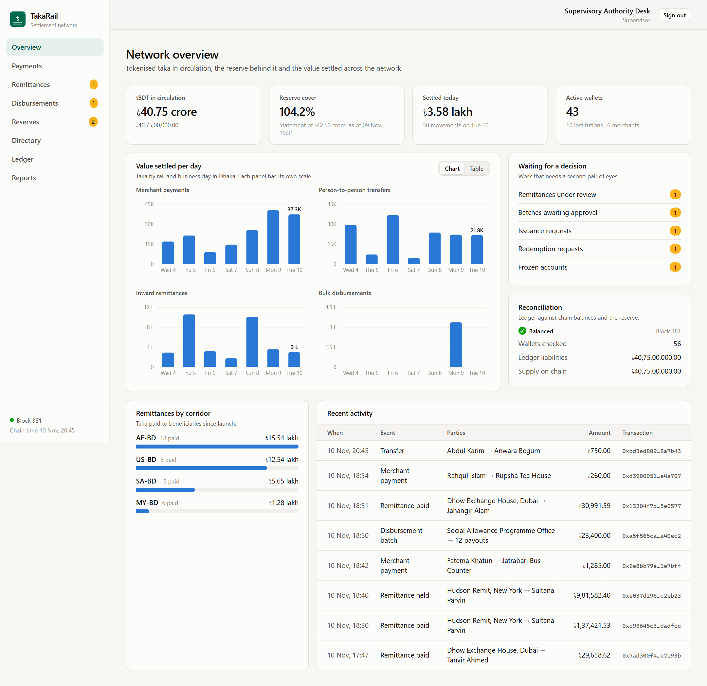

## Contents

- [Why Bangladesh, why now](#why-bangladesh-why-now)
- [What the network does](#what-the-network-does)
- [Architecture](#architecture)
- [How value moves](#how-value-moves)
- [The console](#the-console)
- [Run it](#run-it)
- [Quality gates](#quality-gates)
- [Design decisions](#design-decisions)
- [Status and path to production](#status-and-path-to-production)
- [Repository layout](#repository-layout)

## Why Bangladesh, why now

| What is happening                                                                                                                                                                                                                                                                                                    | What it asks of the infrastructure                                                                                 |
| -------------------------------------------------------------------------------------------------------------------------------------------------------------------------------------------------------------------------------------------------------------------------------------------------------------------- | ------------------------------------------------------------------------------------------------------------------ |
| Workers abroad sent home about USD 30 billion in FY2024-25, a record, and the government adds a 2.5% cash incentive to remittances that arrive through formal channels ([The Business Standard](https://www.tbsnews.net/economy/remittance-inflow-hits-record-30b-fy25-1176781)).                                    | A formal channel that pays the beneficiary in seconds, shows the rate, and adds the incentive without paperwork.   |
| Bangla QR, the national QR standard built on the EMVCo specification, became mandatory for digital merchant payments in 2026 ([Prothom Alo](https://en.prothomalo.com/business/local/h5dlqaen8x), [The Financial Express](https://thefinancialexpress.com.bd/trade/bb-mandates-bangla-qr-for-all-digital-payments)). | One code that any wallet can pay, with settlement the merchant can rely on at once.                                |
| Transfers between banks and mobile wallets are being unified through the National Payment Switch ([The Daily Star](https://www.thedailystar.net/business/news/cross-platform-mfs-transfers-nov-4008981)).                                                                                                            | A single settlement asset shared by banks, mobile financial services and payment service providers.                |
| Millions of garment workers and allowance beneficiaries are paid into wallets every month.                                                                                                                                                                                                                           | Bulk payouts that can be proven, that survive a failed beneficiary, and that return what was not delivered.        |
| Crypto-assets are not permitted for payments or foreign exchange ([The Financial Express](https://today.thefinancialexpress.com.bd/print/virtual-asset-currency-use-restricted-1663263085)).                                                                                                                         | A permissioned ledger run by licensed institutions, where the token is a claim on taka in a bank and nothing else. |

TakaRail is designed inside those lines. It is not a public cryptocurrency. Only institutions admitted
by the network operator can take part, every wallet is opened by an institution after KYC, and the
supervisor can see and stop any of it.

## What the network does

| Module          | Contract               | What it does                                                                                                                                                                  |
| --------------- | ---------------------- | ----------------------------------------------------------------------------------------------------------------------------------------------------------------------------- |
| Directory       | `ParticipantRegistry`  | Licensed institutions, the accounts they sponsor, KYC tiers and the limits of each tier. No personal data on chain.                                                           |
| Tokenised taka  | `TokenisedTaka` (tBDT) | One unit is one poisha. Moves only between active accounts, inside per-transaction, daily and balance limits. The business day rolls over at midnight in Dhaka.               |
| Reserve         | `ReserveController`    | Maker-checker issuance against bank transfers into the trust account. Supply can never exceed the most recent reserve statement. Redemption burns.                            |
| Retail payments | `PaymentSwitch`        | Merchant payments with a fee split between acquirer and network, person-to-person transfers, refunds. An invoice can be paid only once.                                       |
| Remittances     | `RemittanceGateway`    | Corridors with a published reference rate, straight-through payout below a screening threshold, compliance review above it, and the 2.5% incentive paid from a Treasury pool. |
| Bulk payouts    | `DisbursementHub`      | A payer funds a batch and commits to its payout list with a Merkle root. The payer's bank approves, payouts execute in chunks, failures return to the payer.                  |

Around the contracts:

- **Settlement API** (`services/api`): follows the chain, projects events into PostgreSQL read models,
  posts every token movement to a double-entry journal, reconciles the books against chain balances and
  the reserve statement, and exposes role-gated endpoints that sign transactions through a custody
  keystore.
- **Operations console** (`apps/console`): the screens each role works in, from the compliance queue to
  the reserve desk.
- **SDK** (`packages/sdk`): contract ABIs, poisha-exact money maths, instruction encoders and a Bangla QR
  codec, shared by the API and the console.

## Architecture

<picture>
  <source media="(prefers-color-scheme: dark)" srcset="docs/diagrams/architecture-dark.png">
  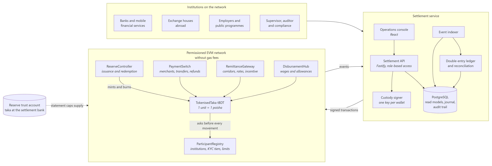
</picture>

Three things carry the design:

1. **The token asks the registry before every movement.** Eligibility, freezes, institution
   suspensions and tier limits are enforced in one place, whichever module initiates the transfer.
2. **Funds and instruction travel together.** A holder calls `transferAndCall(module, amount,
instruction)` (ERC-1363). The module receives the funds and the instruction in the same transaction,
   so no module ever holds an allowance over anybody's wallet.
3. **The chain is the record, the database is a view.** The indexer applies a batch of blocks and its
   cursor in one database transaction. Read models and the ledger always describe the chain exactly up
   to the cursor, and can be rebuilt from it.

More detail: [architecture](docs/architecture.md), [contract reference](docs/contracts.md),
[operations guide](docs/operations.md).

## How value moves

### A merchant payment by Bangla QR

<picture>
  <source media="(prefers-color-scheme: dark)" srcset="docs/diagrams/merchant-payment-dark.png">
  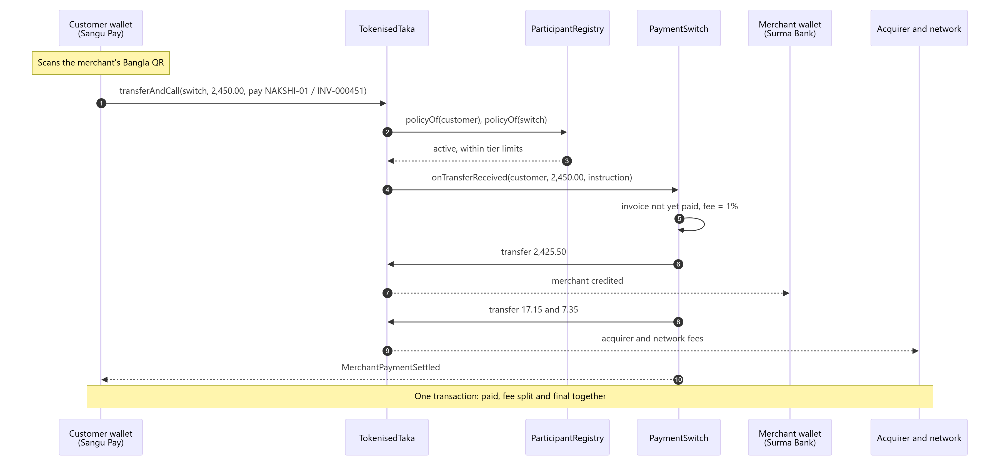
</picture>

A customer of a mobile wallet pays a merchant acquired by a bank. The merchant is credited, the acquirer
and the network receive their share of the fee, and the invoice is marked as paid, all in one
transaction that is final when it is mined.

### An inward remittance

<picture>
  <source media="(prefers-color-scheme: dark)" srcset="docs/diagrams/remittance-dark.png">
  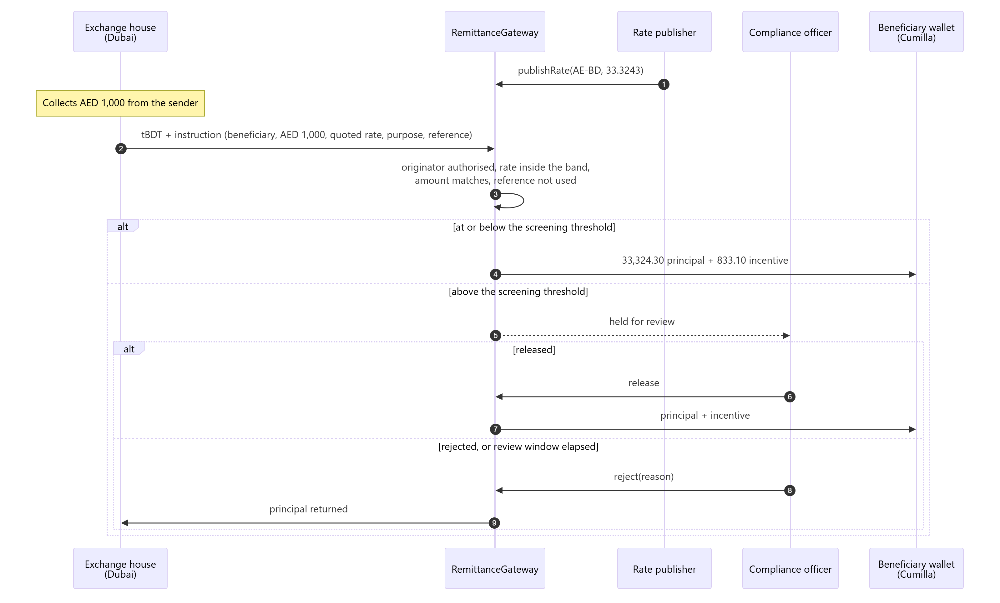
</picture>

The gateway accepts a remittance only from an exchange house authorised on the corridor, only at a rate
inside the band around the published reference rate, and only once per originator reference. The
incentive comes from a pool the Treasury funds; a short pool never holds back the principal.

### Issuance, payroll and reconciliation

|                                                                                                                                                                                                                                                                                                 |                                                                                                                                                                                                                                                                                                            |
| ----------------------------------------------------------------------------------------------------------------------------------------------------------------------------------------------------------------------------------------------------------------------------------------------- | ---------------------------------------------------------------------------------------------------------------------------------------------------------------------------------------------------------------------------------------------------------------------------------------------------------- |
| <picture><source media="(prefers-color-scheme: dark)" srcset="docs/diagrams/issuance-dark.png">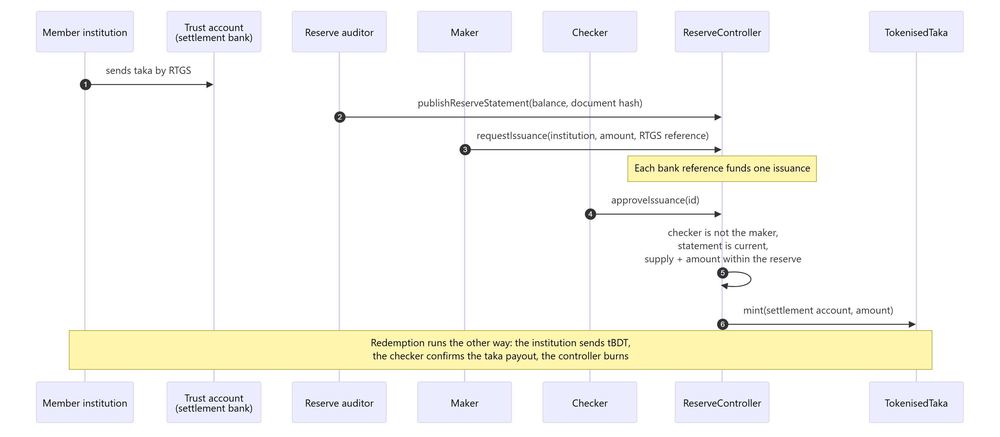</picture> | <picture><source media="(prefers-color-scheme: dark)" srcset="docs/diagrams/disbursement-dark.png">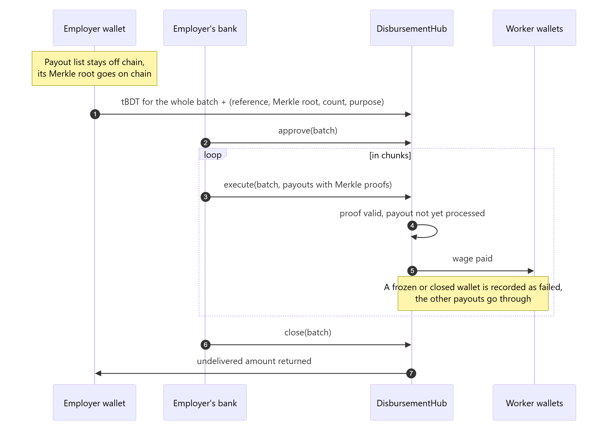</picture> |

<picture>
  <source media="(prefers-color-scheme: dark)" srcset="docs/diagrams/reconciliation-dark.png">
  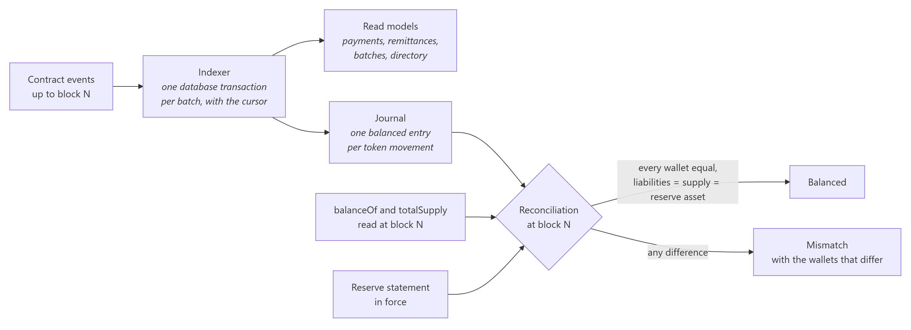
</picture>

## The console

|                                                                                                                                                                                                  |                                                                                                                                                                     |
| ------------------------------------------------------------------------------------------------------------------------------------------------------------------------------------------------ | ------------------------------------------------------------------------------------------------------------------------------------------------------------------- |
| 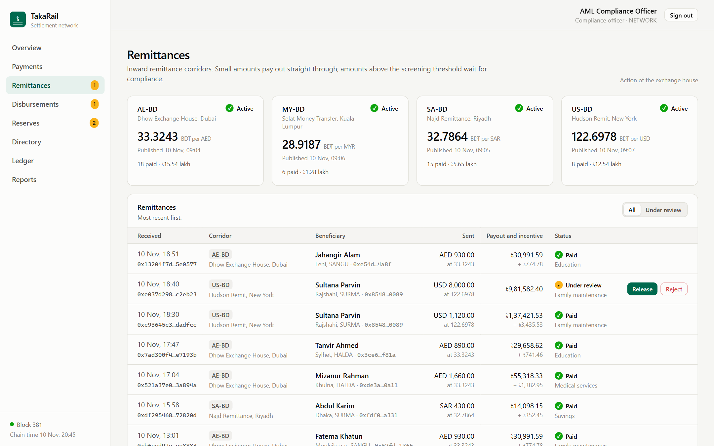 **Remittances.** Corridors with their reference rate, and the queue a compliance officer releases or rejects. | 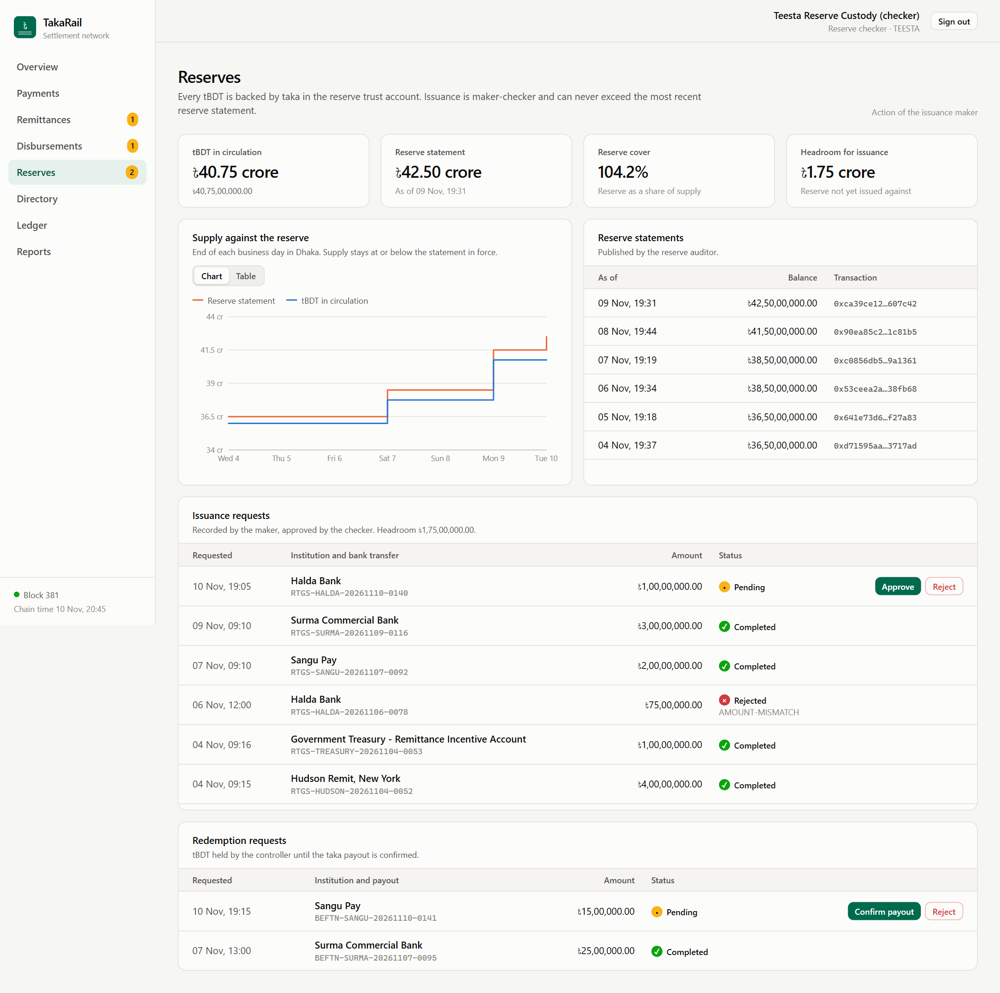 **Reserves.** Supply against the reserve statement, with maker-checker issuance and redemption.                      |
| 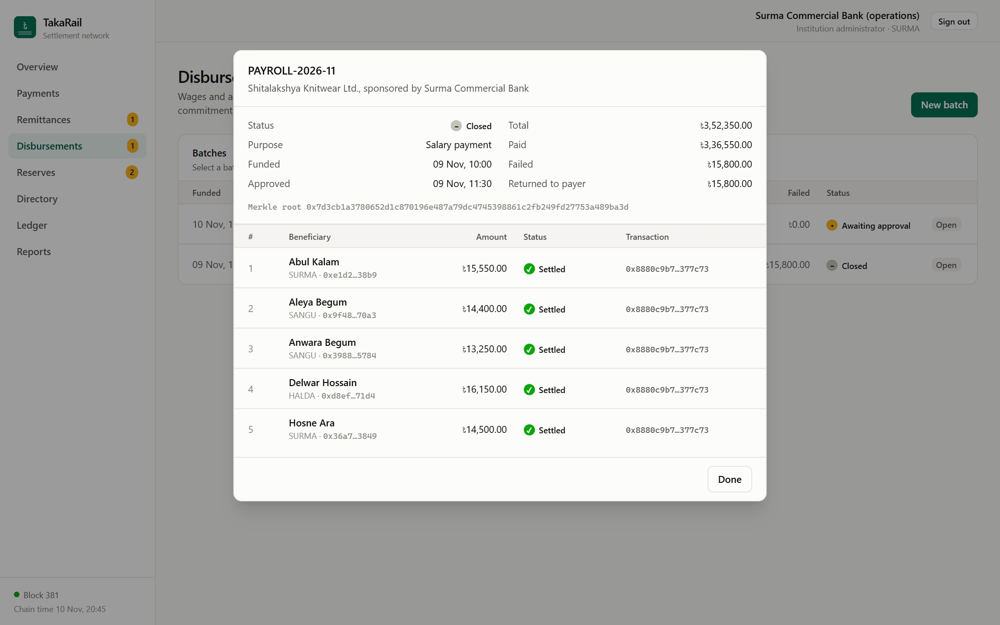 **Disbursements.** A payroll batch: 23 wages paid, one returned because the worker's wallet was frozen.               | 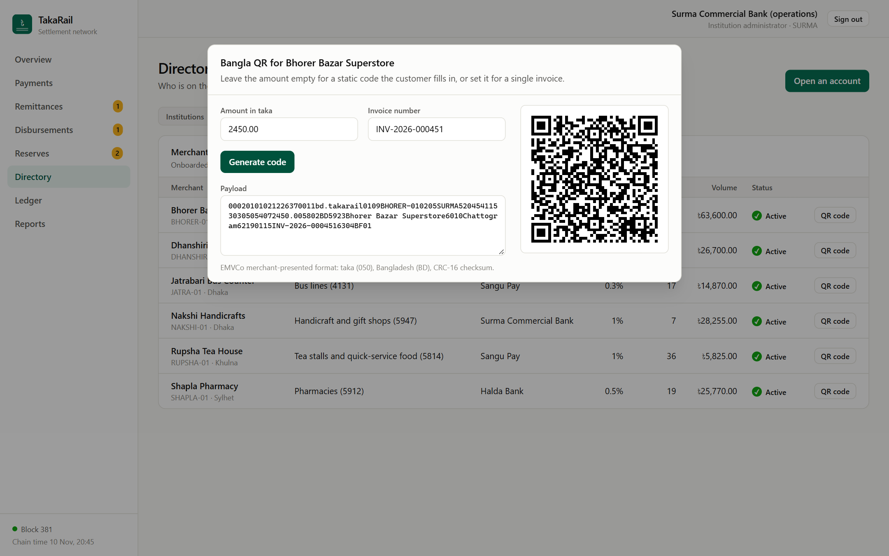 **Bangla QR.** A dynamic merchant code in the EMVCo format, ready to be paid from any wallet on the network. |
| 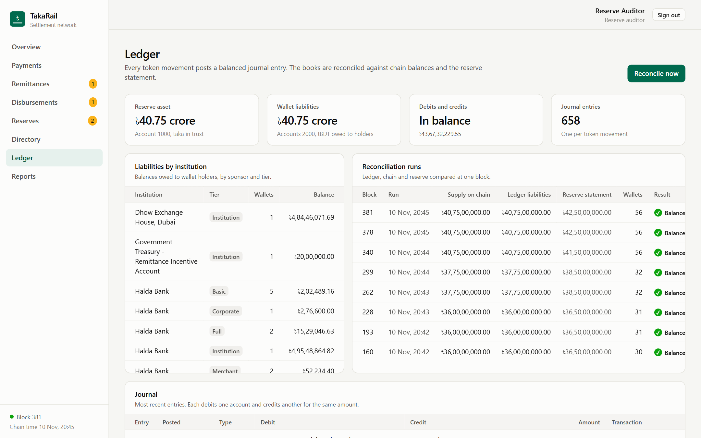 **Ledger.** Reserve asset against wallet liabilities, the journal and the reconciliation runs.                                         | 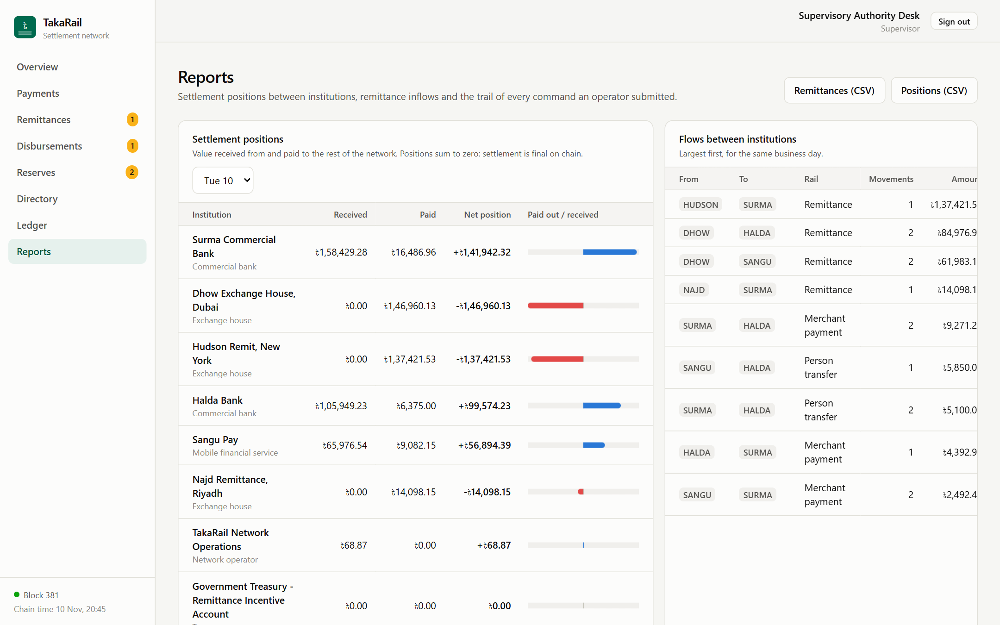 **Reports.** Daily positions between institutions and the trail of every command.                             |
| 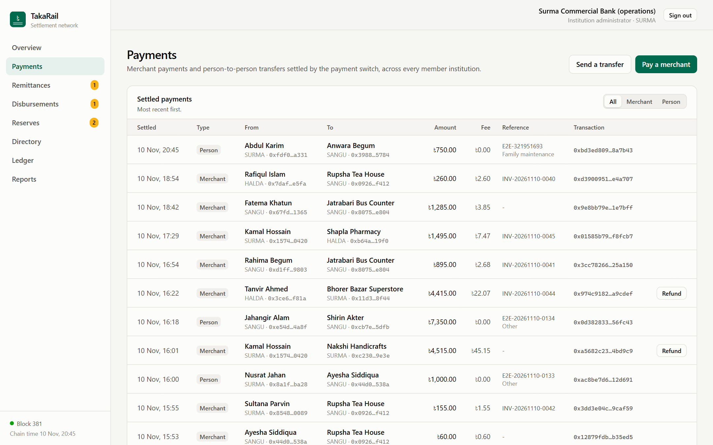 **Payments.** Merchant payments and transfers across institutions.                                                                                    | 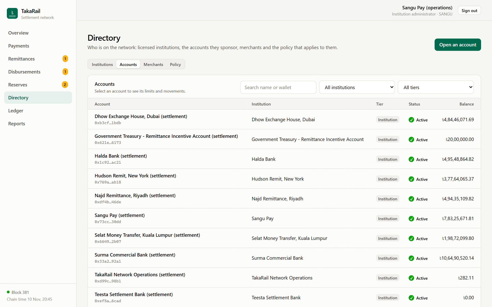 **Directory.** Accounts with tier, status and balance.                                                         |

Each role sees the same network and can act only where its duties lie. The maker records an issuance and
cannot approve it; the checker approves and cannot record; an institution administrator acts on its own
customers only.

## Run it

Requirements: Node.js 22, pnpm 10, Docker.

```bash
pnpm install
```

```bash
pnpm setup
```

`pnpm setup` writes `.env` with freshly generated secrets (custody mnemonic, database password, session
secret) and prints the passphrase of the console operators. Then start the pieces:

```bash
pnpm db:up
```

```bash
pnpm chain
```

In a second terminal, deploy the contracts and the reference network, load the operator profiles and
start the API:

```bash
pnpm deploy:local
```

```bash
pnpm seed
```

```bash
pnpm api
```

In a third terminal, play the business week and open the console:

```bash
pnpm scenario
```

```bash
pnpm console
```

The console is at <http://localhost:5180> and the API reference at <http://127.0.0.1:4100/docs>.

### Operator profiles

All profiles share the passphrase printed by `pnpm setup` (`OPERATOR_PASSPHRASE` in `.env`).

| Username                                                    | Role                      | Acts on                                                          |
| ----------------------------------------------------------- | ------------------------- | ---------------------------------------------------------------- |
| `ops.network`                                               | Network operator          | Reconciliation, audit trail                                      |
| `supervisor`                                                | Supervisor                | Freezes any account, audit trail                                 |
| `maker.teesta`                                              | Issuance maker            | Records issuance, publishes reference rates                      |
| `checker.teesta`                                            | Reserve checker           | Approves issuance, confirms redemption payouts                   |
| `auditor`                                                   | Reserve auditor           | Publishes reserve statements, reconciles                         |
| `compliance`                                                | Compliance officer        | Releases or rejects remittances under review                     |
| `admin.surma`, `admin.halda`, `admin.sangu`, `admin.teesta` | Institution administrator | Own customers: accounts, payments, cash-in and cash-out, batches |
| `ops.dhow`, `ops.najd`, `ops.selat`, `ops.hudson`           | Exchange house            | Sends remittances on its corridor                                |
| `treasury`                                                  | Treasury                  | Funds the incentive pool                                         |

### What the reference scenario leaves for you

The scenario plays about 280 operations over seven business days and ends at the present. It leaves
work waiting for a decision, so every role has something to do:

| Sign in as       | Then                                                                                                                          |
| ---------------- | ----------------------------------------------------------------------------------------------------------------------------- |
| `compliance`     | Release or reject the USD 8,000 remittance under review.                                                                      |
| `admin.halda`    | Open the allowance batch, approve it and execute its 12 payouts.                                                              |
| `checker.teesta` | Approve the pending issuance for Halda Bank; confirm the redemption of Sangu Pay.                                             |
| `admin.surma`    | Pay a merchant from a customer wallet. Try ৳30,000 from a basic wallet: the token refuses it with `TransactionLimitExceeded`. |
| `ops.dhow`       | Send a remittance and watch the quote, the payout and the incentive.                                                          |
| `auditor`        | Reconcile the ledger against the chain.                                                                                       |

## Quality gates

```bash
pnpm spec
```

```bash
pnpm typecheck
```

```bash
pnpm format:check
```

- **88 contract specifications** cover every contract: roles, limits, maker-checker, rate bands,
  Merkle proofs, refunds and failure paths. A separate suite checks conservation of value across all
  modules: the whole supply sits in known accounts, stays within the reserve, and every module holds
  exactly what it owes.
- **24 SDK specifications** cover poisha-exact money maths, reference packing, the Bangla QR codec
  including its checksum, and the payout Merkle tree.
- **The reference scenario** runs the full stack and ends with a three-way reconciliation
  (ledger, chain balances, reserve) that must come out balanced.
- TypeScript is strict in every package, and the database refuses a journal entry whose debits and
  credits differ.

## Design decisions

| Decision                                         | Why                                                                                                                                                    |
| ------------------------------------------------ | ------------------------------------------------------------------------------------------------------------------------------------------------------ |
| Token with two decimals                          | One unit is one poisha, so the chain, the ledger and the reports share exact integers.                                                                 |
| Limits in the token, eligibility in the registry | A limit cannot be bypassed by going through a different module, and a freeze takes effect everywhere at once.                                          |
| ERC-1363 instead of allowances                   | Paying is one transaction, and no contract can pull funds from a wallet later.                                                                         |
| Business references on chain                     | Invoice numbers, bank transfer references and originator references are accepted once, which makes retries safe.                                       |
| Reserve statement as a hard cap                  | Issuance beyond the statement, or on a statement older than two days, reverts.                                                                         |
| Principal never waits for the incentive          | A short incentive pool defers the incentive, not the remittance.                                                                                       |
| Merkle root for payout lists                     | A payroll of thousands commits in one transaction, and names and amounts stay off chain.                                                               |
| Failed payouts are recorded, not reverted        | One frozen wallet does not block the wages of everyone else.                                                                                           |
| No gas fee                                       | The network is permissioned; access is controlled by the registry, so wallets need no second asset.                                                    |
| Custodial keys behind an interface               | Customers in Bangladesh use wallets held by their institution. The custody service derives keys by index; an HSM or KMS takes its place in production. |
| Database as a rebuildable view                   | Read models and the journal come from events only, so they can be dropped and replayed.                                                                |

## Status and path to production

This is a reference implementation. It runs end to end on a local EVM node and has not had an external
security audit. It is not connected to live banking rails, and it is not affiliated with Bangladesh Bank
or with any bank, mobile financial service or exchange house. Institution and merchant names in the
reference network are fictional. Operating a network like this needs the approval of the regulator.

What a production deployment adds:

- A permissioned network such as Hyperledger Besu with QBFT, validators run by member institutions and
  the operator, and governance keys held in a multi-signature wallet with a time lock.
- Hardware-backed custody (HSM or cloud KMS) behind the existing signer interface.
- ISO 20022 gateways to the National Payment Switch, BEFTN and BD-RTGS for funding and redemption.
- Per-institution data partitioning in the API, so each member reads only its own customers.
- An external audit of the contracts and a penetration review of the service.
- Sanctions and transaction-monitoring integrations feeding the compliance queue.

## Repository layout

```text
contracts/          Solidity contracts, specifications, deployment and ABI export (Hardhat)
  src/              ParticipantRegistry, TokenisedTaka and the settlement modules
  spec/             Contract specifications
packages/sdk/       ABIs, money maths, instruction encoders, Bangla QR codec
services/api/       Settlement API: indexer, ledger, reconciliation, endpoints, scenario
apps/console/       Operations console (React, Vite, Tailwind)
network/            Reference network: institutions, corridors, accounts, policy
docs/               Architecture, contract reference, operations guide, diagrams, screenshots
scripts/            Environment setup, diagram rendering, screenshot capture
```

## Licence

[MIT](LICENSE)
